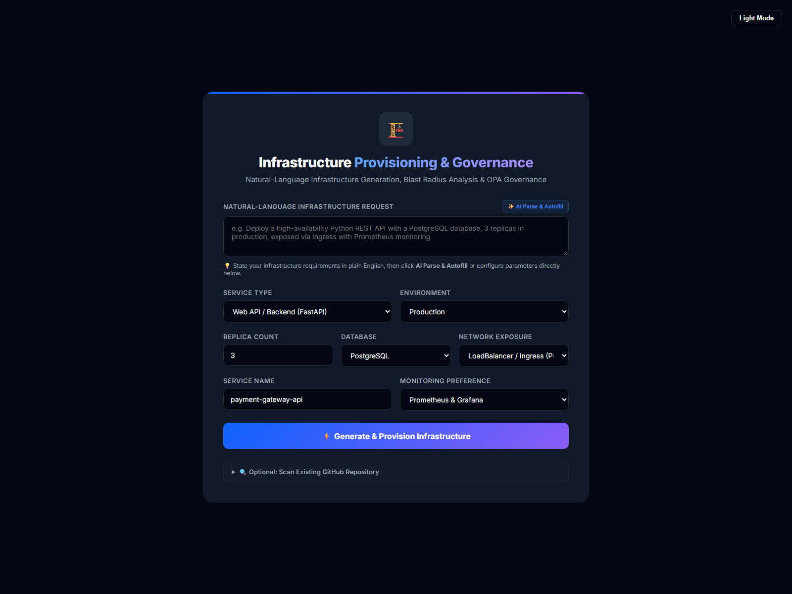

# AI-Powered Infrastructure Provisioning & Governance Platform

Turn an infrastructure request into a validated specification, generated configuration, a reviewable Terraform plan analysis, and a governed local Kubernetes deployment workflow.



## What it does

- Parses natural-language requirements with a local Ollama model or deterministic rules, then validates the result with Pydantic.
- Generates Terraform, Kubernetes, Dockerfile, and Compose configurations from the specification.
- Validates generated configuration and analyzes Terraform plans, resource changes, dependencies, and blast radius.
- Evaluates deterministic governance rules and records explicit human approval or rejection.
- Deploys generated Kubernetes manifests only to a validated local Kind cluster after approval.
- Tracks services and deployment status in a local SQLite registry.

Terraform plan analysis never runs `terraform apply`. The UI's **Generate & Provision Infrastructure** action generates and reviews artifacts; it does not provision infrastructure. The separate Kubernetes deployment endpoint is restricted to local Kind contexts and requires an approved record.

## Architecture

See [the architecture and workflow guide](docs/architecture.md) for the component diagram, API flow, and implementation boundaries.

## Windows quick start

Requirements: Python 3.10 or later and PowerShell.

```powershell
git clone https://github.com/PiyushAgarwalcs/AI-Powered-Infrastructure-Provisioning-Governance-Platform.git
Set-Location 'AI-Powered-Infrastructure-Provisioning-Governance-Platform'
py -3.10 -m venv .venv
.\.venv\Scripts\Activate.ps1
python -m pip install --upgrade pip
python -m pip install -r requirements.txt
python main.py
```

Open [http://127.0.0.1:8000](http://127.0.0.1:8000). No API key, cloud account, Redis server, Terraform, or Kind cluster is required to use the request form, rule-based parser, generators, and mock plan analysis.

For detailed Windows setup, local Ollama, Terraform, Kind, and safety instructions, read the [setup guide](docs/setup.md).

## Local development and tests

```powershell
python -m pip install -r requirements-dev.txt
python -m pytest -q
```

See the [testing guide](docs/testing.md) for focused checks and integration-test boundaries.

## Project layout

```text
infra_platform/
  ai/              Model provider adapters
  analysis/        Repository analysis, costs, reporting, and exports
  collaboration/   Sessions, comments, and WebSocket coordination
  infrastructure/  Specs, generators, validation, plans, governance, Kind, registry
templates/         Dashboard HTML and browser-side code
tests/             Automated tests by workflow area
docs/              Setup, testing, architecture, and historical project notes
monitoring/         Monitoring configuration
main.py             FastAPI application and local entry point
```

See the [documentation index](docs/README.md) for the guide map and the [architecture guide](docs/architecture.md) for module responsibilities.

## API

FastAPI's interactive API reference is available at [http://127.0.0.1:8000/docs](http://127.0.0.1:8000/docs) while the app is running. The main workflow endpoints are:

| Method | Path | Purpose |
| --- | --- | --- |
| `POST` | `/api/infrastructure/parse` | Parse a request using Ollama or rule-based extraction |
| `POST` | `/api/infrastructure/generate` | Generate and validate files from an infrastructure specification |
| `POST` | `/api/infrastructure/download` | Download generated files as a ZIP |
| `POST` | `/api/provision/request` | Generate the dashboard's artifact bundle from form selections; does not provision |
| `POST` | `/api/terraform/analyze` | Analyze generated HCL with a mock plan by default, or the optional Terraform CLI |
| `POST` | `/api/terraform/blast-radius` | Analyze a supplied Terraform plan JSON document |
| `POST` | `/api/governance/evaluate` | Evaluate policies and create a pending approval record |
| `POST` | `/api/governance/approve` / `/api/governance/reject` | Record an explicit approval decision |
| `GET` | `/api/governance/approval/{approval_id}` | Retrieve an approval record |
| `GET` | `/api/kubernetes/clusters` | List local Kind clusters |
| `POST` | `/api/kubernetes/deploy` | Deploy a matching approved specification to a local Kind cluster |
| `GET` | `/api/kubernetes/status` | Read workload status from a local Kind cluster |
| `GET`, `POST` | `/api/services` | List or register services |
| `GET`, `PATCH`, `DELETE` | `/api/services/{environment}/{service_name}` | Read, update, or remove a registered service |
| `GET` | `/health` | Application health check |

## Technology

Python, FastAPI, Pydantic, Ollama (optional/local), deterministic Python policy checks, Terraform CLI (optional), Kubernetes/Kind (optional/local), SQLite, and a vanilla HTML/CSS/JavaScript dashboard.

## Safety and limitations

- The governance rules are implemented in Python; an OPA binary or Rego policy bundle is **not** integrated.
- Approval records are held in process memory and disappear when the server restarts. The app has no user authentication or authorization. Run it only on a trusted local machine; do not expose it to an untrusted network.
- Terraform analysis does not apply plans or create cloud resources. CLI planning can still contact Terraform providers and should only be used with configuration and credentials you trust.
- Kind deployment requires Docker, Kind, kubectl, an existing local cluster, and the generated application image loaded into that cluster.
- Generated configuration is a starting point, not production-ready infrastructure. Review it, replace example credentials, and apply your organization's security controls before use.
- Live Kind provisioning has not been verified in the development environment; its automated tests mock external commands.

## Attribution and license

This project grew from the ShipSage/RepoSage codebase and retains its repository-analysis and generator components: [AbhishekKharat04/repo-sage](https://github.com/AbhishekKharat04/repo-sage). No `LICENSE` file is present in this checkout; consult the upstream repository's terms before redistributing or reusing its work.
