# Architecture and workflow

## Component diagram

```mermaid
flowchart LR
    Operator["Operator / browser"] --> Dashboard["FastAPI-served dashboard"]
    Dashboard --> API["FastAPI routes"]
    API --> Parser["Requirement parser"]
    Parser --> Ollama["Optional local Ollama"]
    Parser --> Rules["Deterministic rule fallback"]
    Ollama --> Spec["Pydantic InfrastructureSpec"]
    Rules --> Spec
    Spec --> Generators["Terraform, Kubernetes, Docker, Compose generators"]
    Generators --> Validators["Configuration validators"]
    Validators --> Artifacts["Reviewable generated files"]
    Artifacts --> Plan["Terraform plan analysis"]
    Plan --> Blast["Deterministic change and blast-radius analysis"]
    Blast --> Policies["Python governance rules"]
    Policies --> Approval["In-memory human approval record"]
    Approval -->|"approved specification"| Provisioner["Local Kind provisioner"]
    Provisioner -->|"validated context and allow-listed kubectl operations"| Kind["Local Kind cluster"]
    Provisioner --> Registry["SQLite service registry"]
    Kind --> Registry
    API --> Sessions["Optional Redis-backed collaboration sessions"]
```

## Request-to-deployment flow

1. The dashboard accepts a natural-language request and infrastructure selections. `POST /api/infrastructure/parse` uses Ollama when selected and reachable, otherwise the parser can use deterministic rules. The result is validated against `InfrastructureSpec`; missing or invalid fields are returned for review.
2. `POST /api/infrastructure/generate` creates Terraform, Kubernetes, Dockerfile, and Compose outputs and runs configuration validators. `POST /api/infrastructure/download` packages generated outputs as a ZIP.
3. `POST /api/terraform/analyze` uses a deterministic mock plan by default. When explicitly requested and Terraform is installed, it runs a restricted CLI sequence (`fmt`, `init -backend=false`, `validate`, `plan`, and `show -json`). `POST /api/terraform/blast-radius` can instead parse a caller-supplied plan JSON document.
4. The plan changes and specification can be evaluated through `POST /api/governance/evaluate`. The policy result and plan hash are stored with an approval record. A human must explicitly approve or reject it.
5. `POST /api/kubernetes/deploy` accepts a validated specification, an approval ID, and a Kind cluster name. It verifies the approved record and specification, rechecks applicable policies, validates generated manifests and the cluster's loopback API context, then calls `kubectl apply` and checks rollout status.
6. Successful or not-ready deployments and subsequent status checks update the local SQLite service registry.

The dashboard's **Generate & Provision Infrastructure** button generates an artifact bundle; it is not an automatic cloud or cluster deployment action.

## Implementation boundaries

- **Governance:** `governance.py` implements deterministic rules in Python. Although some API/UI descriptions say “OPA-equivalent,” this checkout does not execute OPA and does not contain a Rego bundle.
- **Terraform:** analysis is read-only. The runner does not invoke `terraform apply`; its temporary working files are discarded. Generated Terraform may describe cloud infrastructure, but the platform does not create those cloud resources.
- **Kubernetes:** deployment is restricted to a Kind cluster whose configured API server resolves to loopback. `kubectl` is invoked as an argument list, not through a model-generated shell command. The service image must already be built and loaded into the cluster.
- **Approval:** approval records are held in memory and are lost on restart. The server has no authentication or authorization layer, so an approval is not proof of a user's identity.
- **Persistence:** service records use SQLite (`infrastructure_registry.sqlite3` by default, configurable with `INFRASTRUCTURE_REGISTRY_DB`). Redis is optional for the legacy collaboration/session manager.
- **Legacy code:** repository-analysis and collaboration routes remain in the codebase; the infrastructure workflow is the primary documented product path.

## Main code map

| Area | Files |
| --- | --- |
| API, startup, dashboard routes | `main.py`, `templates/index.html` |
| Parsing and specification | `requirement_parser.py`, `ai_providers.py` |
| Configuration generation and validation | `generators.py`, `config_validator.py` |
| Terraform plan and blast-radius analysis | `terraform_runner.py` |
| Governance and approval records | `governance.py` |
| Local Kubernetes deployment and status | `kubernetes_provisioner.py` |
| Service registry | `service_registry.py` |
| Automated tests | `tests/` |
